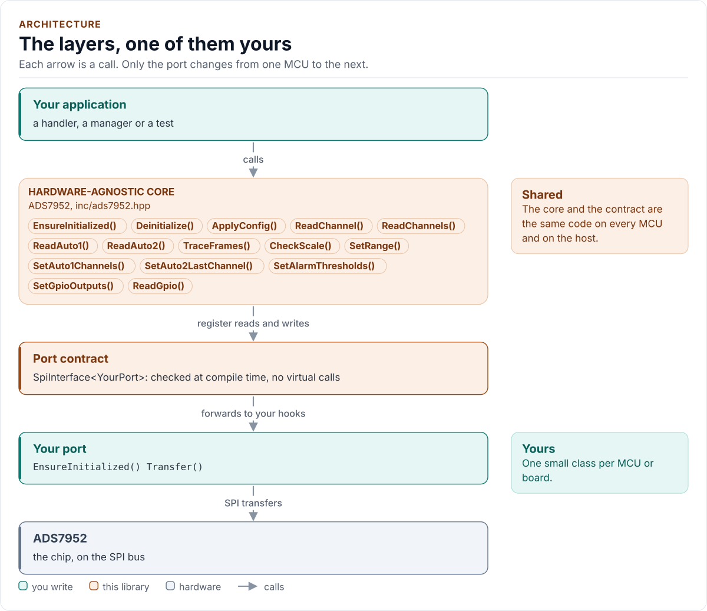

# ADS7952 Driver

C++20 driver for the TI ADS7950, ADS7951, ADS7952 and ADS7953 12-bit SPI SAR ADCs.

[](https://github.com/kokeb-labs-drivers/driver-ads7952/actions/workflows/ci.yml)
[](LICENSE)
[](docs/installation.md#requirements)

**Documentation: [`docs/`](docs/index.md)**, with the API reference built by Doxygen ([how](docs/api-reference.md)).
The site at <https://kokeb-labs-drivers.github.io/driver-ads7952/> opens when the repository is public.

The ADS7952 converts twelve analog inputs to 12 bits, one per 16-bit SPI frame, at up to 1 MSPS: a bank of pressure
gauges, supply rails, temperature sensors. This driver resets the chip and checks that it really answers before it
trusts the bus, reads one channel, a list or a whole programmed sequence with the fewest frames the chip allows, keys
every result on the channel address in its reply, and sets the range, the alarms and the GPIOs. It runs on any MCU:
you give it a small class that moves one frame on your SPI bus and waits, and it does the rest.

<!-- figure: driver-layers -->
<picture>
  <source media="(prefers-color-scheme: dark)" srcset="docs/diagrams/driver-layers.dark.svg">
  
</picture>
<!-- /figure -->

## At a glance

| | |
| --- | --- |
| **Chips** | TI ADS7950 (4 channels), ADS7951 (8), ADS7952 (12), ADS7953 (16); 12 bits; TSSOP or VQFN. The 10- and 8-bit ADS7954 to ADS7961 are not supported |
| **Converts** | 0 to VREF or 0 to 2 x VREF with an external 2.0 V to 3.0 V reference; up to 1 MSPS |
| **Bus** | SPI mode 0, up to 20 MHz; one 16-bit frame per conversion, the result two frames after its channel |
| **Modes** | Manual (a channel per frame), Auto-1 (a programmed list), Auto-2 (channel 0 to a last channel) |
| **Extras** | Two alarm thresholds per channel on GPIO0 and GPIO1; four GPIOs on TSSOP; power-down |
| **Driver** | Header-only C++20; no heap, exceptions, RTTI or virtual calls; every call returns `Result<T>` |
| **Runs on** | Any MCU with SPI and a C++20 compiler; examples for ESP32 (ESP-IDF) and the host |
| **Status** | 0.1.0, **not verified on hardware**: host-tested against a protocol model of the chip and fuzzed; the bench steps are in [limitations](docs/limitations.md) |

## Datasheet

<!-- generated: datasheet-card -->
| Document | Revision | Get it |
| --- | --- | --- |
| Datasheet: ADS79xx 12-, 10-, 8-Bit, 1-MSPS, 16-, 12-, 8-, 4-Channel, Single-Ended, Serial Interface ADCs (Texas Instruments SLAS605) | C, 2018-07 | [PDF](https://www.ti.com/lit/ds/symlink/ads7952.pdf) · [vendor page](https://www.ti.com/product/ADS7952) |

Written against these revisions; the SHA-256 of each file is in [`docs/datasheets.yml`](docs/datasheets.yml). Where each
part of the driver is in the datasheet: [Datasheet map](docs/datasheet.md).
<!-- /generated -->

Every docs page lists the datasheet sections it relies on, and code comments cite the section they implement.

## Try it on your PC

No hardware needed: [`examples/host`](examples/host/README.md) runs the real driver against a simulated chip. You need
git, CMake 3.16+ and a C++20 compiler (GCC 10+, Clang 13+ or MSVC 2022).

1. Get the source:

   ```bash
   git clone https://github.com/kokeb-labs-drivers/driver-ads7952.git && cd driver-ads7952
   ```

2. Build and run the example:

   ```bash
   cmake -S examples/host -B build-example
   cmake --build build-example
   ./build-example/ads7952_host_example
   ```

3. You should see the chip started, one channel read and two passes of an eight-channel Auto-1 sequence:

   ```text
   ADS7952 driver 0.1.0 on the host
   ads7952: initialised
   CH3: 901 (549926 uV)
   CH0=163 CH1=409 CH2=655 CH3=901 CH6=1638 CH7=1884 CH9=2375 CH11=2867
   CH0=163 CH1=409 CH2=655 CH3=901 CH6=1638 CH7=1884 CH9=2375 CH11=2867
   ```

To run the whole test suite instead: `cmake -S . -B build -DADS7952_BUILD_TESTS=ON && cmake --build build && ctest
--test-dir build`.

## Use it on your MCU

**1. Wire it** (TSSOP-38; [Hardware](docs/hardware.md) for the other parts and packages):

| MCU | ADS7952 |
| --- | --- |
| SPI SCLK, MOSI, MISO | SCLK (pin 32), SDI (pin 33), SDO (pin 34) |
| Chip select | CS (pin 31): low for one 16-bit frame, high between frames |
| MCU I/O supply | +VBD (pin 36), 1.7 V to +VA |
| 2.7 V to 5.25 V, a 2.5 V reference | +VA (pins 5, 29); REFP, REFM (pins 4, 3) with 10 µF between them |
| | MXO (pin 7) to AINP (pin 8), AINM (pin 9) to ground; the inputs on CH0 to CH11 |

**2. Write the port**: a class with `EnsureInitialized()` (bring the bus up), `Transfer()` (one 16-bit frame with CS
low) and `DelayUs()`, about 25 lines on most SDKs. [Porting](docs/porting.md) has the contract and a complete
example.

**3. Read a channel:**

<!-- generated: quickstart-code -->
```cpp
#include "ads7952.hpp"

int read_input_3(MyPort& port, uint32_t& microvolts) {
  ads7952::ADS7952<MyPort> adc(port); // no I/O yet; Config{} is an ADS7952 at its reset state

  if (auto r = adc.EnsureInitialized(); !r) { // 1. bus up, reset, registers, identity check
    return static_cast<int>(r.error);         //    Bus, NoDevice or DeviceIdMismatch: check wiring
  }
  const auto code = adc.ReadChannel(3); // 2. Manual mode: select, acquire, convert
  if (!code) {
    return static_cast<int>(code.error); //    ChannelMismatch: a reply for another channel
  }
  microvolts = adc.ToMicrovolts(code.value); // 3. 0 to VREF, one LSB = VREF / 4096
  return 0;
}
```
<!-- /generated -->

`EnsureInitialized()` is the only call that starts the driver, and the only one that probes: the constructor clocks
nothing, so a board can build it at boot and probe later, when the analog board is plugged in. Every other call returns
`Error::NotInitialized` until the probe has succeeded.

## What it does

- Starts the chip from a known state: ends any program sequence an earlier failure left open, resets every register
  through the GPIO program register, writes the configuration.
- Checks the chip before trusting it: selects a channel, keeps it, selects one whose address differs in every bit,
  and demands those addresses back two frames later. A MISO line stuck low or high, a fixed reply word, an echo and an
  SDI line that never reaches the chip all fail: a chip without SDI stays on channel 0, its reset state (datasheet
  sections 8.4.1, 8.4.7), so a probe of channel 0 alone would pass.
- Tracks the frame pipeline: a repeated Manual channel costs one frame, a running Auto-1 or Auto-2 scan one frame per
  channel, a list `n + 2` frames. Every result is keyed on the address in its reply (`ChannelMismatch`,
  `SequenceMismatch`), never inferred from frame counting.
- Detects a reset behind its back where the replies show it: a reply from channel 0, the power-on channel, where it
  expects another is `DeviceReset`, and after it (or any mismatch) the driver is uninitialised until
  `EnsureInitialized()` programs the chip again. `ApplyConfig()` writes every register, never a difference from its
  own copy.
- Sends the range and GPIO levels with every mode word, the read frame of `ReadChannel()` included, so a chip reset
  behind its back gets them back at once; skips the reply converted in the old range after `SetRange()`.
- Sends only what the datasheet needs by default: the read-backs the chip allows (GPIO levels, the scanned sequence)
  are opt-in, per call.
- Programs the Auto-1 and Auto-2 sequences, the alarm thresholds and the GPIOs, and repairs a program sequence a
  failed frame left open, so the chip never takes the next command as data.

## Add it to your project

Pick the row that matches your build; each is a few steps, and [Installation](docs/installation.md) has the details.

| Your build | Steps below |
| --- | --- |
| Plain CMake: STM32 (CubeMX), RP2040 (Pico SDK), nRF Connect, a host app | [A](#a-cmake-any-mcu) |
| ESP-IDF | [B](#b-esp-idf) |
| An SDK or OS image that installs libraries | [C](#c-installed-package) |

### A. CMake, any MCU

1. Add the driver as a submodule, pinned to the version you chose:

   ```bash
   git submodule add https://github.com/kokeb-labs-drivers/driver-ads7952.git external/driver-ads7952
   ```

2. In your `CMakeLists.txt`, after `project()`:

   ```cmake
   add_subdirectory(external/driver-ads7952)
   target_link_libraries(my_app PRIVATE ads7952::ads7952)   # brings the headers and C++20
   ```

3. In your code, `#include "ads7952.hpp"`, write the port ([Porting](docs/porting.md)) and build. A first build
   that compiles the quickstart above is the check that the driver is wired in.

### B. ESP-IDF

1. Add the driver under your project's `components/`; ESP-IDF finds it there and names it after the folder:

   ```bash
   git submodule add https://github.com/kokeb-labs-drivers/driver-ads7952.git components/ads7952
   ```

2. In `main/CMakeLists.txt`, list it: `idf_component_register(SRCS "main.cpp" REQUIRES ads7952)`.
3. `idf.py menuconfig` now has an **ADS7950 / ADS7951 / ADS7952 / ADS7953 SAR ADC** menu (the part, the package,
   the range, the reference and the sequences), and `idf.py build` builds the driver with your app.
   [`examples/esp32`](examples/esp32) is a complete project with an SPI port.

### C. Installed package

1. Install it once into a prefix:

   ```bash
   cmake -S external/driver-ads7952 -B build-ads7952 && cmake --install build-ads7952 --prefix /opt/sdk
   ```

2. In your project, with `CMAKE_PREFIX_PATH=/opt/sdk`:

   ```cmake
   find_package(ads7952 0.1 REQUIRED)
   target_link_libraries(my_app PRIVATE ads7952::ads7952)
   ```

The target is `ads7952::ads7952` every way, so switching later changes nothing else.

## Documentation

| Page | Read it when you want to |
| --- | --- |
| [Quickstart](docs/quickstart.md) | Go from a bare chip to its first result on your MCU |
| [Hardware](docs/hardware.md) | Wire it, pick the clock, understand the frame, the modes and the registers |
| [Porting](docs/porting.md) | Write the port class for your MCU's SDK |
| [API guide](docs/api-guide.md) | Use each call: start, read, scan, range, alarms, GPIOs, use it from a handler, handle errors |
| [Configuration](docs/configuration.md) | Choose the part, the range, the sequences, the GPIOs and the alarms |
| [Troubleshooting](docs/troubleshooting.md) | Find the cause of an error from the replies |
| [Contract](docs/contract.md) | Know exactly what the driver promises, needs and returns, frame by frame |
| [Status and limitations](docs/limitations.md) | Decide whether it is ready for your use: what is and is not verified, each design choice with its datasheet section, and the bench steps |
| [Datasheet map](docs/datasheet.md) | Find the datasheet section behind each part of the driver |
| [API reference](docs/api-reference.md) | Look up a class or member (Doxygen; built by CI and locally) |

## Tests and quality

```bash
cmake -S . -B build -DADS7952_BUILD_TESTS=ON && cmake --build build && ctest --test-dir build
```

The host tests run the driver against a protocol model of the chip with the bus and board faults a real board can
produce (MISO floating, stuck low or carrying a fixed word, SDI not reaching the chip, a brown-out back to Range 1),
fail every frame of every operation in turn, before and after the chip takes it, and produce each error the driver can
return. A fuzzer fails, loses, corrupts and replaces the chip's replies and checks the driver's promises after every
call, among them that a dead bus never passes the start-up and that no conversion returns another channel's result. CI
also builds for Cortex-M0+ to M7F and ESP32, and gates coverage, complexity, sanitizers, fuzzing, clang-tidy, cppcheck
and the [Kokeb Labs handbook](https://github.com/kokeb-labs/handbook) rules. See [Testing](docs/testing.md), which
lists every gate and its limit.

## License

MIT. See [LICENSE](LICENSE).
