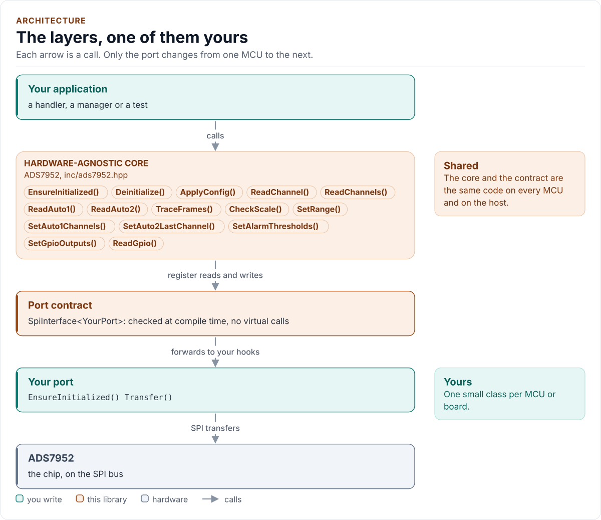
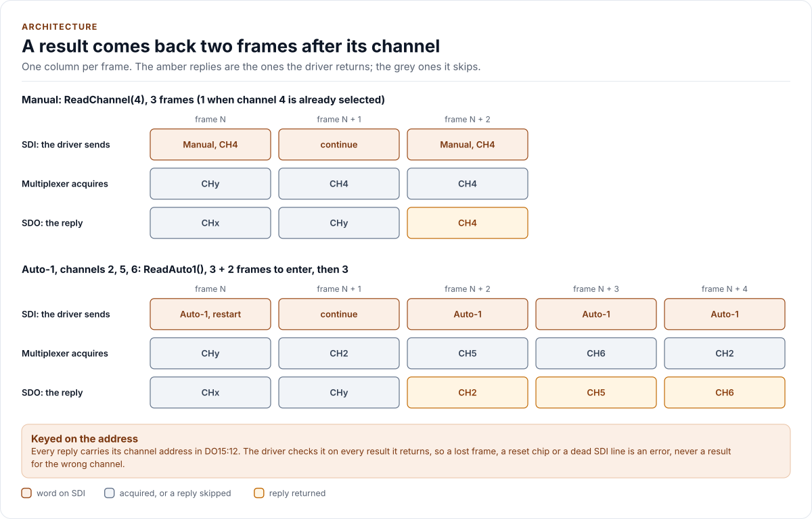
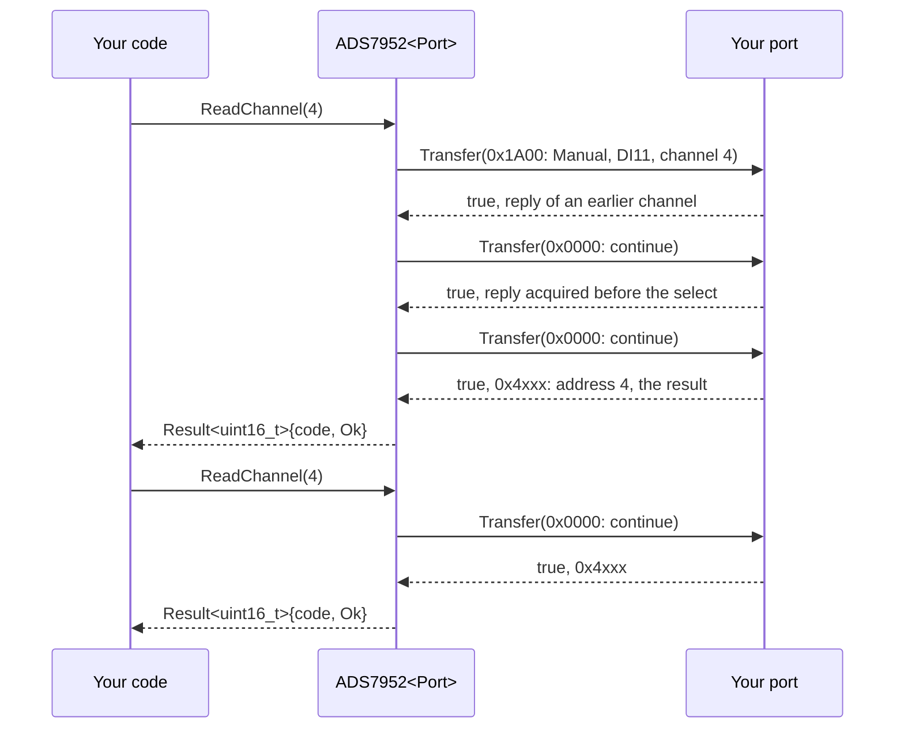

# Architecture

How the driver is built: three layers, one of them yours, and what happens in each when you read a channel.

<!-- generated: datasheet-refs -->
??? abstract "Datasheet sections this page relies on"

    From Texas Instruments SLAS605 C:

    - Frame, reply word, GPIO refresh and alarm timing: 8.1 Overview, [p. 28](https://www.ti.com/lit/ds/symlink/ads7952.pdf#page=28)
    - Manual mode and the two-frame read latency: 8.4.4 Operating in Manual Mode, Figures 50 and 51, Table 1, [p. 31](https://www.ti.com/lit/ds/symlink/ads7952.pdf#page=31)
    - Auto-1 mode and its program register: 8.4.5 Operating in Auto-1 Mode, Figures 52 to 54, Tables 2 to 4, [p. 34](https://www.ti.com/lit/ds/symlink/ads7952.pdf#page=34)
    - The "continue" word: 8.4.7 Continued Operation in a Selected Mode, Table 7, [p. 41](https://www.ti.com/lit/ds/symlink/ads7952.pdf#page=41)

    All of them, with the driver API for each: [Datasheet map](datasheet.md).
<!-- /generated -->

<!-- figure: driver-layers -->
<picture>
  <source media="(prefers-color-scheme: dark)" srcset="diagrams/driver-layers.dark.svg">
  
</picture>
<!-- /figure -->

## Layers

| Layer | Files | Owns |
| --- | --- | --- |
| Core | [`inc/ads7952.hpp`](../inc/ads7952.hpp), [`src/ads7952.ipp`](../src/ads7952.ipp) | Lifecycle, reset and identity check, the frame pipeline (mode, selected channel, replies in flight), address checks, program sequences and their repair, errors |
| Types and frame format | [`inc/ads7952_types.hpp`](../inc/ads7952_types.hpp), [`inc/ads7952_registers.hpp`](../inc/ads7952_registers.hpp) | `Error`, `Result<T>`, `Variant`, `Package`, `Range`, `Verify`, `GpioConfig`, `AlarmThreshold`, `Bank`, `Config`; the command words and the reply fields |
| Port contract | [`inc/ads7952_spi_interface.hpp`](../inc/ads7952_spi_interface.hpp) | The CRTP base, the `SpiPort` concept, `detail::FrameBus` (one 16-bit frame per transfer, MSB first) |
| Platform port | Your class | Bus bring-up, transfers and a delay; optionally logging |
| Kconfig layer | [`inc/ads7952_kconfig.hpp`](../inc/ads7952_kconfig.hpp) | Optional: a `Config` from ESP-IDF menuconfig |

## The pipeline the core tracks

<!-- figure: frame-pipeline -->
<picture>
  <source media="(prefers-color-scheme: dark)" srcset="diagrams/frame-pipeline.dark.svg">
  
</picture>
<!-- /figure -->

The chip answers each frame with the result of the channel the frame before last chose (Figures 51 and 53). The core
keeps three facts so that each call sends the fewest frames and returns only results that belong to it: the mode the
chip is in (Manual, Auto-1, Auto-2, or unknown after a failure), the Manual channel, and how many replies still in
flight were acquired before its last change (a select, an Auto entry, a new range or sequence). A read that does not
need to choose the channel lets those replies pass; any other read chooses it again, which also sends the range. A
reply's address is always checked against the channel it must carry.

## One read through the layers

A scan is drawn on the [API guide](api-guide.md#scan-a-sequence-the-hot-path): after the entry, one Auto-1 word
(DI11 = 1, no restart) per channel.

## Design choices

- **CRTP, not virtual functions.** The port is a template parameter constrained by the `SpiPort` concept, so every
  call is resolved at compile time and a missing hook is a compile error that names it.
- **Optional hooks by named concepts.** `DelayUs` and `Log` are detected by `HasDelayUs` and `HasLog` in one place,
  which match the hook's address against exactly one `noexcept` signature (`detail::ExactHook`). A missing
  `DelayUs()` fails to compile, and so does a hook declared with another signature; a missing `Log()` logs nothing.
- **No I/O in the constructor.** Construction cannot fail and clocks nothing, so the driver can be a static or a
  member of a handler built at boot, before the board is plugged in.
- **Key every result on its address.** The chip tags each reply with its channel; the driver never infers a channel
  from frame counting alone. A lost frame, a reset chip or a deaf SDI line becomes an error, not a wrong value.
- **Minimum frames, extra checks per call.** The hot path sends one mode word per result; the read-backs the chip
  allows (GPIO levels, the scanned sequence) are asked for per call with `Verify::ReadBack`.
- **No mode calls.** The driver enters Manual, Auto-1 or Auto-2 when a read needs it; the caller never has to keep
  the chip's mode and the driver's view in step.
- **One error type.** `Result<T>` carries a value and an `Error`; nothing throws and nothing returns a bare `bool`.
- **No heap, no exceptions, no RTTI, no `std::function`, no `printf`.** The driver is a header-only template with
  no mutable static state.

## Source map

| You want | Read |
| --- | --- |
| The public API | [`inc/ads7952.hpp`](../inc/ads7952.hpp) |
| How a call is implemented | [`src/ads7952.ipp`](../src/ads7952.ipp) |
| Command words and reply fields | [`inc/ads7952_registers.hpp`](../inc/ads7952_registers.hpp) |
| The port contract and the frame | [`inc/ads7952_spi_interface.hpp`](../inc/ads7952_spi_interface.hpp) |

Next: [Contract](contract.md).
