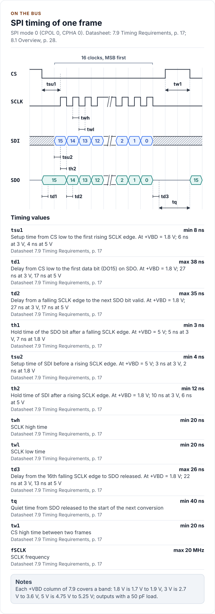

# On the bus

What the ADS7952 needs from the SPI bus, signal by signal, with every time and rate taken from the datasheet. The
command word and the reply of a frame are on the [Hardware](hardware.md) page; this page is the waveform under them.

## SPI timing

Every frame is one 16-bit word with CS low. The falling edge of CS samples the selected input, starts the conversion
and puts DO15 on SDO; the chip reads SDI on the rising edge of SCLK and changes SDO on the falling edge (mode 0), and
releases SDO after the 16th falling edge (section 8.1). The driver sends one frame per `Transfer()` call and raises
CS between frames; the [porting guide](porting.md#bus-requirements) lists the constants a port checks against.

<!-- figure: spi-timing -->
<picture>
  <source media="(prefers-color-scheme: dark)" srcset="diagrams/spi-timing.dark.svg">
  
</picture>
<!-- /figure -->

## Several devices

The datasheet describes no daisy chain and no addressing: several ADS7952 on one SPI bus share SCLK, SDI and SDO,
and each needs its own CS. SDO is released after the 16th clock and while CS is high (section 7.9, td3 and td4), so
the other devices can drive the line between frames.

## How these figures are made

Each figure is a model in `docs/model/` (`spi-timing.timing.yml`) that cites the datasheet section and page of every
number; `kokeb-docs figures` draws it and the build fails on a number without a citation. The values table under the
waveform is also written as `docs/diagrams/spi-timing.table.html`.
