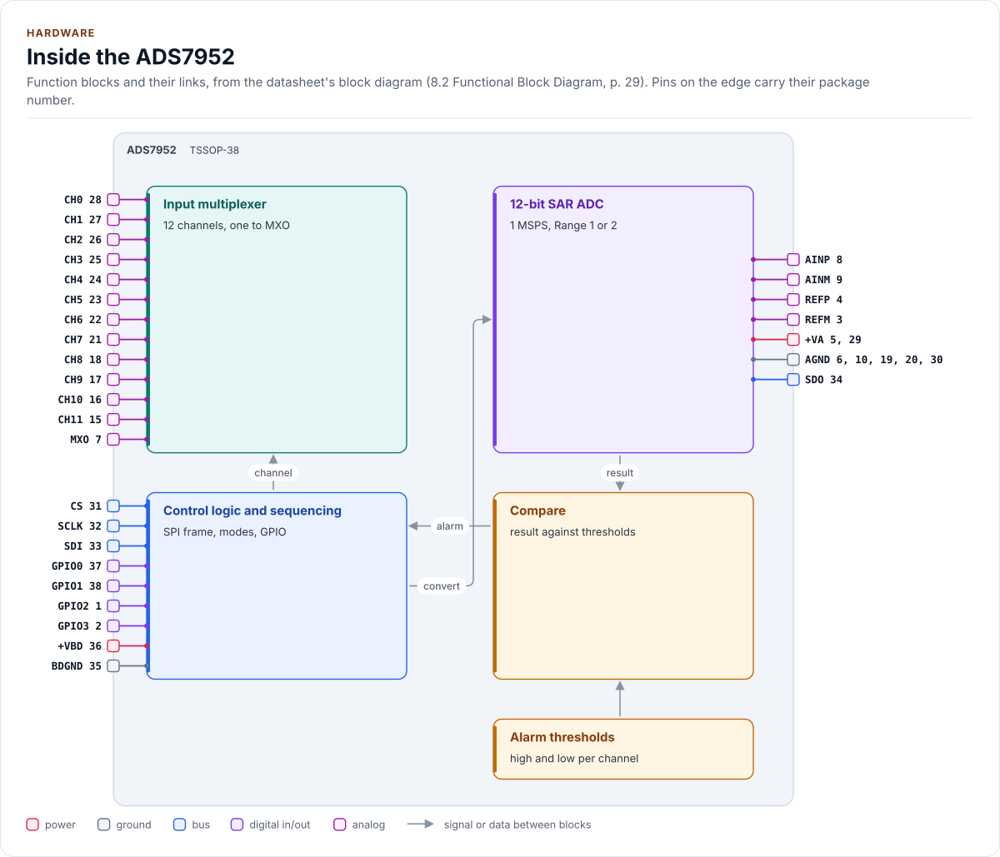
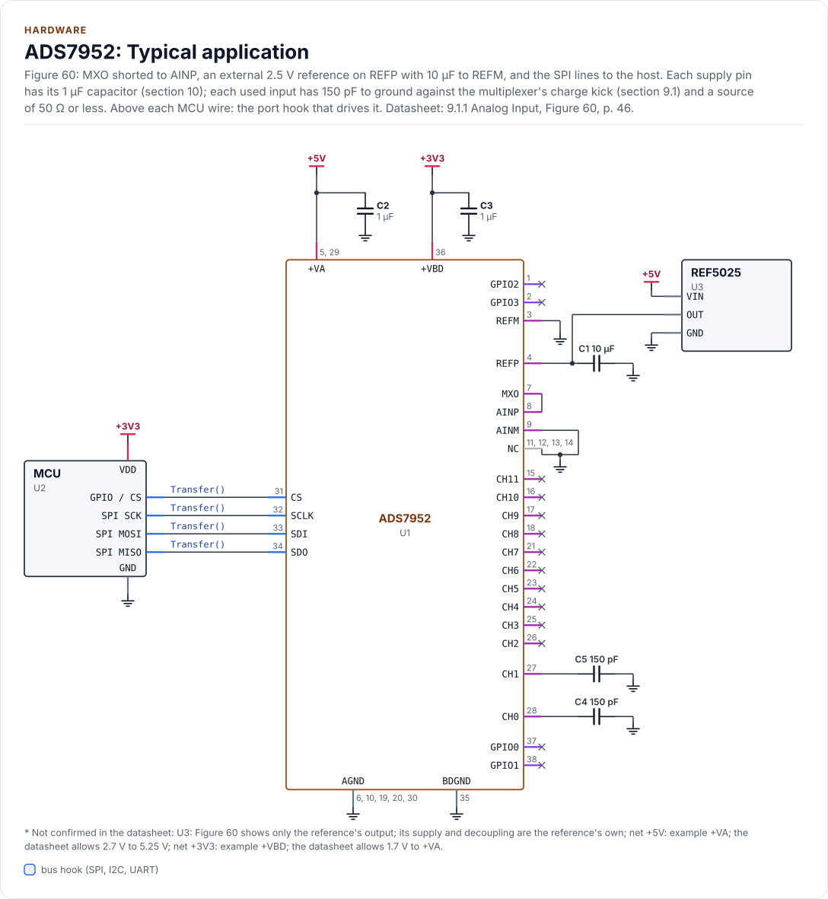
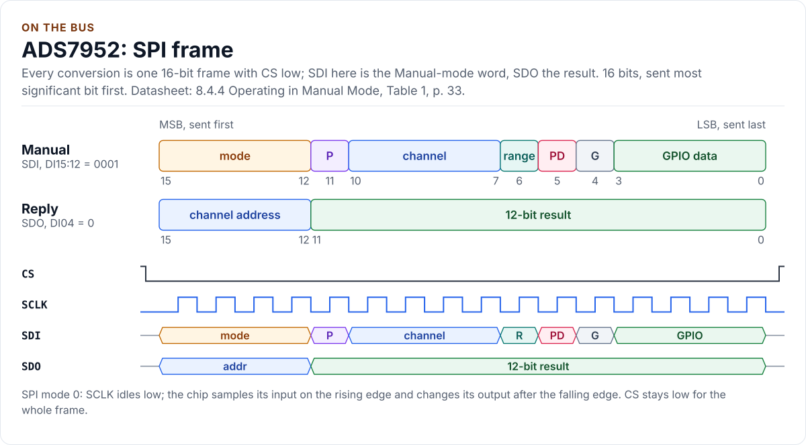
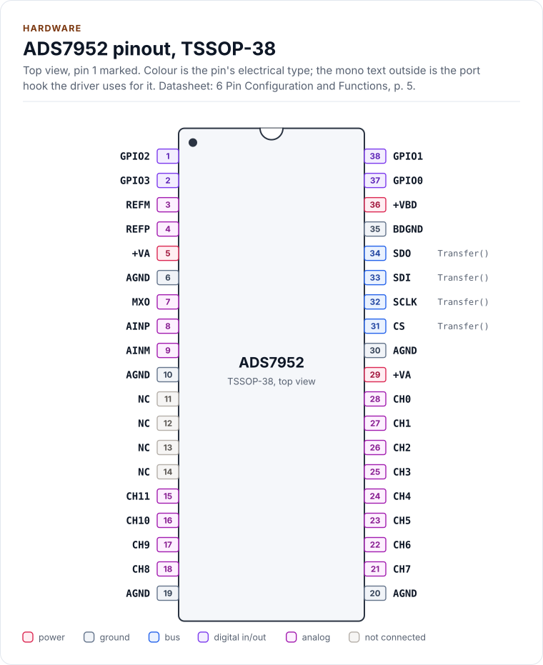
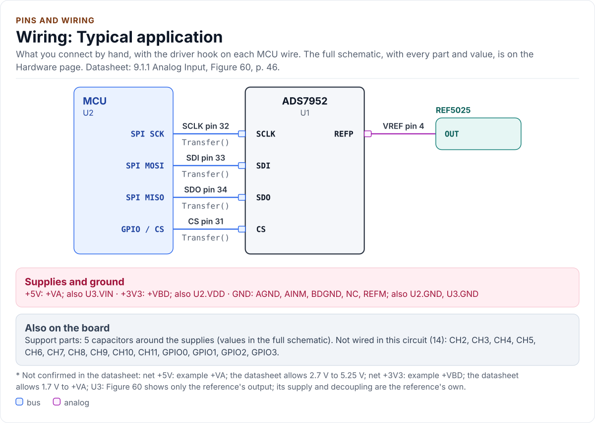
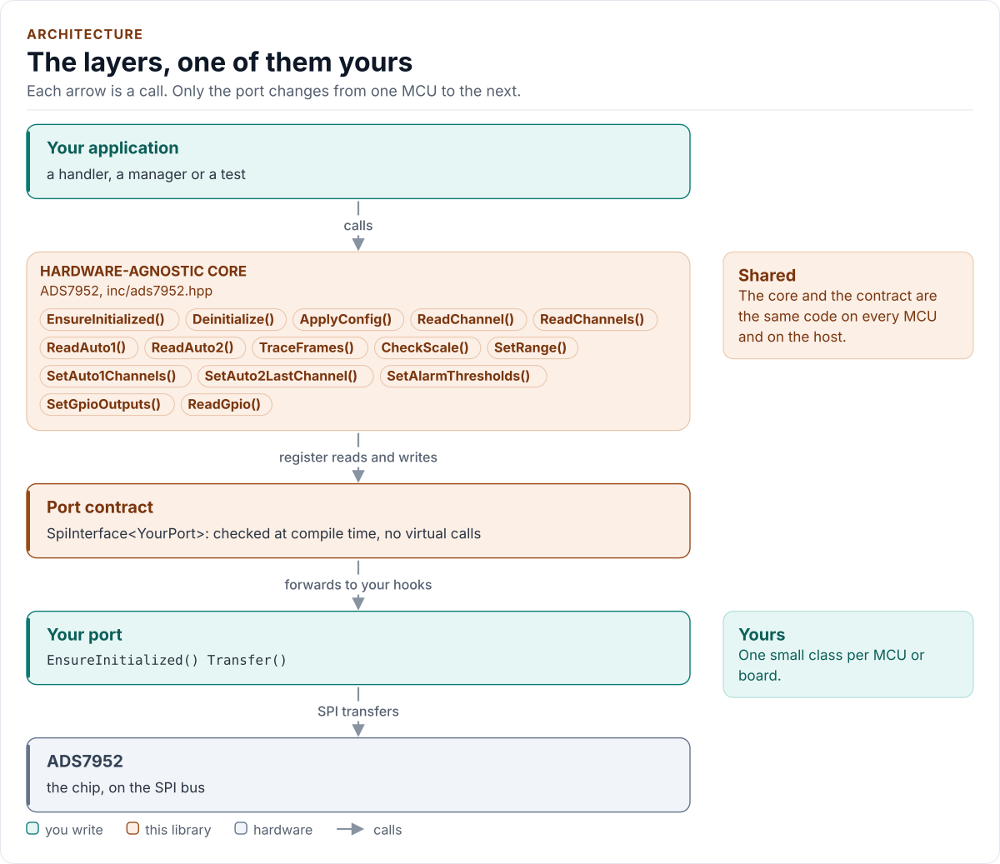
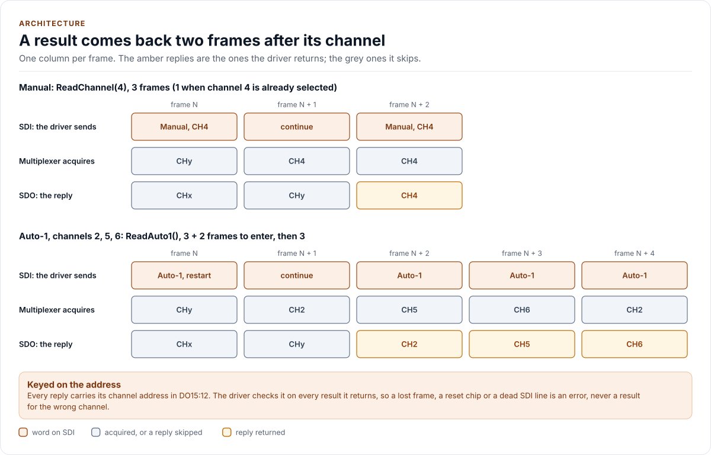
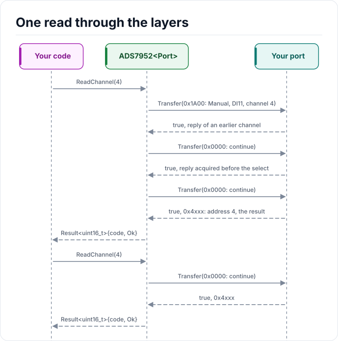
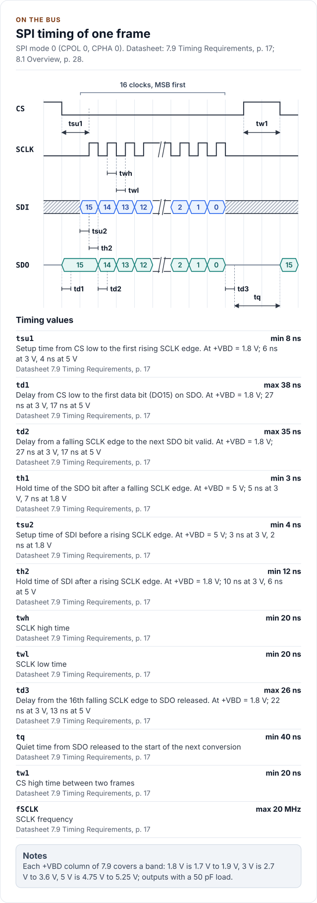

# Figures

<!-- Written by kokeb-docs figures from docs/diagrams/figures/*.py. Do not edit by hand. -->

Every figure on this site is drawn by a Python module from facts extracted from the code, so it is rebuilt,
not redrawn, when the code changes. CI runs `kokeb-docs figures --check` and fails when a
committed figure no longer matches the code. Each figure below lists the files it is drawn from.

## Inside the ADS7952

<!-- figure: chip-blocks -->
<picture>
  <source media="(prefers-color-scheme: dark)" srcset="chip-blocks.dark.svg">
  
</picture>
<!-- /figure -->

Hardware description: [`docs/hardware.yml`](../hardware.yml)

Drawn from:

- [`docs/hardware.yml`](../hardware.yml)
- [`inc/ads7952_spi_interface.hpp`](../../inc/ads7952_spi_interface.hpp)

## What the ADS7952 does

<!-- figure: chip-capabilities -->
<picture>
  <source media="(prefers-color-scheme: dark)" srcset="chip-capabilities.dark.svg">
  
</picture>
<!-- /figure -->

Hardware description: [`docs/hardware.yml`](../hardware.yml)

Drawn from:

- [`docs/hardware.yml`](../hardware.yml)
- [`inc/ads7952_spi_interface.hpp`](../../inc/ads7952_spi_interface.hpp)

## ADS7952: Typical application

<!-- figure: chip-circuit-typical -->
<picture>
  <source media="(prefers-color-scheme: dark)" srcset="chip-circuit-typical.dark.svg">
  
</picture>
<!-- /figure -->

Hardware description: [`docs/hardware.yml`](../hardware.yml)

Drawn from:

- [`docs/hardware.yml`](../hardware.yml)
- [`inc/ads7952_spi_interface.hpp`](../../inc/ads7952_spi_interface.hpp)

## ADS7952: SPI frame

<!-- figure: chip-frame-spi -->
<picture>
  <source media="(prefers-color-scheme: dark)" srcset="chip-frame-spi.dark.svg">
  
</picture>
<!-- /figure -->

Hardware description: [`docs/hardware.yml`](../hardware.yml)

Drawn from:

- [`docs/hardware.yml`](../hardware.yml)
- [`inc/ads7952_spi_interface.hpp`](../../inc/ads7952_spi_interface.hpp)

## ADS7952

<!-- figure: chip-hero -->
<picture>
  <source media="(prefers-color-scheme: dark)" srcset="chip-hero.dark.svg">
  
</picture>
<!-- /figure -->

Hardware description: [`docs/hardware.yml`](../hardware.yml)

Drawn from:

- [`docs/hardware.yml`](../hardware.yml)
- [`inc/ads7952_spi_interface.hpp`](../../inc/ads7952_spi_interface.hpp)

## ADS7952 pinout, TSSOP-38

<!-- figure: chip-pinout -->
<picture>
  <source media="(prefers-color-scheme: dark)" srcset="chip-pinout.dark.svg">
  
</picture>
<!-- /figure -->

Hardware description: [`docs/hardware.yml`](../hardware.yml)

Drawn from:

- [`docs/hardware.yml`](../hardware.yml)
- [`inc/ads7952_spi_interface.hpp`](../../inc/ads7952_spi_interface.hpp)

## Wiring: Typical application

<!-- figure: chip-wiring-typical -->
<picture>
  <source media="(prefers-color-scheme: dark)" srcset="chip-wiring-typical.dark.svg">
  
</picture>
<!-- /figure -->

Hardware description: [`docs/hardware.yml`](../hardware.yml)

Drawn from:

- [`docs/hardware.yml`](../hardware.yml)
- [`inc/ads7952_spi_interface.hpp`](../../inc/ads7952_spi_interface.hpp)

## The layers, one of them yours

<!-- figure: driver-layers -->
<picture>
  <source media="(prefers-color-scheme: dark)" srcset="driver-layers.dark.svg">
  
</picture>
<!-- /figure -->

Figure module: [`docs/diagrams/figures/driver-layers.py`](../../docs/diagrams/figures/driver-layers.py)

Drawn from:

- `public calls` in [`inc/ads7952.hpp`](../../inc/ads7952.hpp)
- `SpiInterface` in [`inc/ads7952_spi_interface.hpp`](../../inc/ads7952_spi_interface.hpp)

## A result comes back two frames after its channel

<!-- figure: frame-pipeline -->
<picture>
  <source media="(prefers-color-scheme: dark)" srcset="frame-pipeline.dark.svg">
  
</picture>
<!-- /figure -->

Figure module: [`docs/diagrams/figures/frame-pipeline.py`](../../docs/diagrams/figures/frame-pipeline.py)

Drawn from:

- `select()` in [`src/ads7952.ipp`](../../src/ads7952.ipp)
- `selectChecked()` in [`src/ads7952.ipp`](../../src/ads7952.ipp)
- `readSelected()` in [`src/ads7952.ipp`](../../src/ads7952.ipp)
- `scan()` in [`src/ads7952.ipp`](../../src/ads7952.ipp)
- `kContinue` in [`inc/ads7952_registers.hpp`](../../inc/ads7952_registers.hpp)

## One read through the layers

<!-- figure: one-read-through-the-layers -->
<picture>
  <source media="(prefers-color-scheme: dark)" srcset="one-read-through-the-layers.dark.svg">
  
</picture>
<!-- /figure -->

Hardware description: [`docs/model/one-read-through-the-layers.seq.yml`](../model/one-read-through-the-layers.seq.yml)

Drawn from:

- [`docs/model/one-read-through-the-layers.seq.yml`](../model/one-read-through-the-layers.seq.yml)

## SPI timing of one frame

<!-- figure: spi-timing -->
<picture>
  <source media="(prefers-color-scheme: dark)" srcset="spi-timing.dark.svg">
  
</picture>
<!-- /figure -->

Hardware description: [`docs/model/spi-timing.timing.yml`](../model/spi-timing.timing.yml)

Drawn from:

- [`docs/model/spi-timing.timing.yml`](../model/spi-timing.timing.yml)
