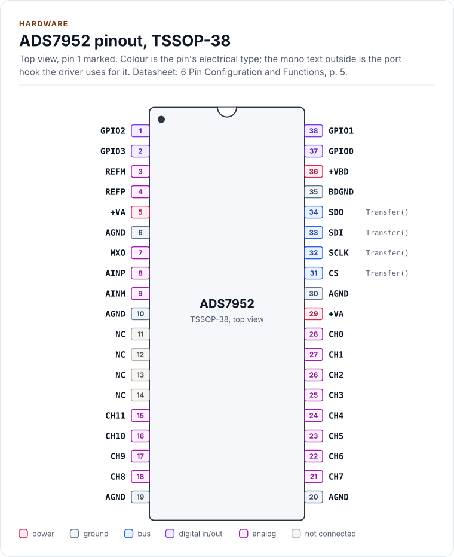
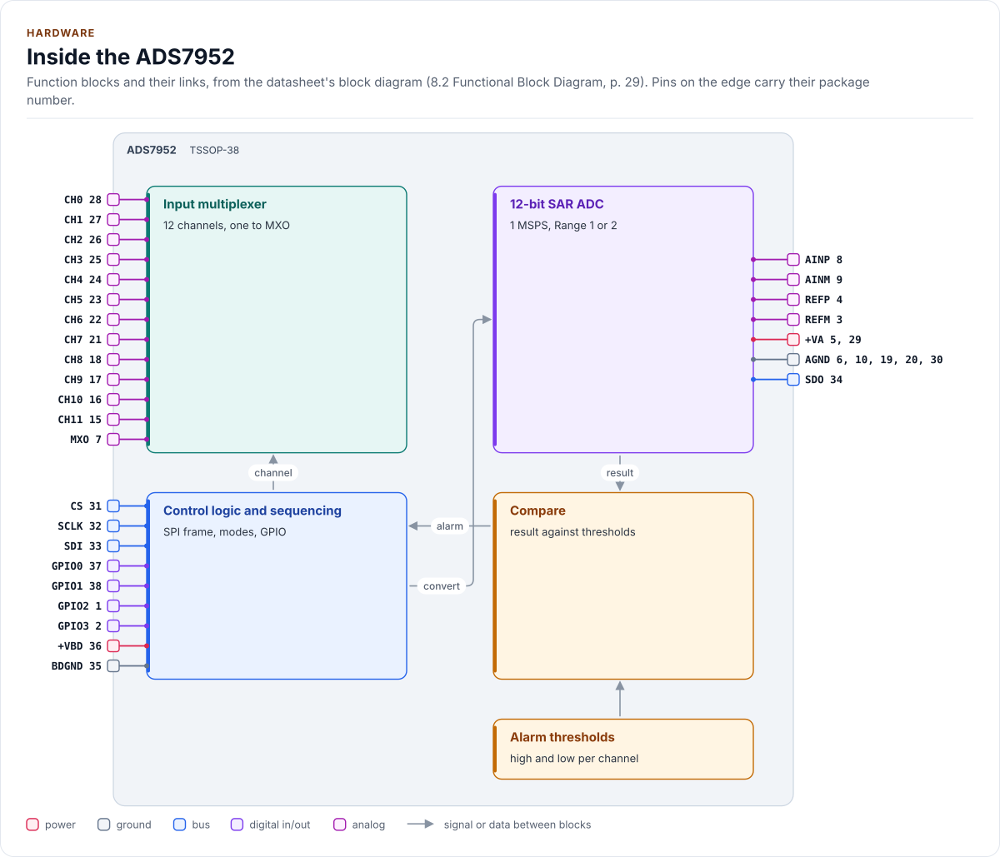
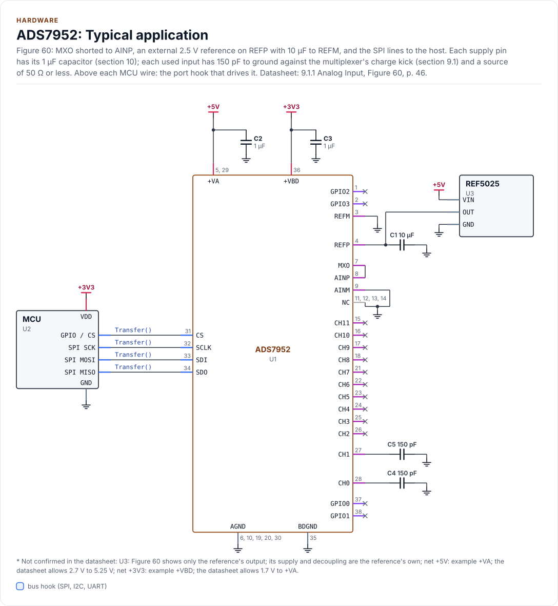
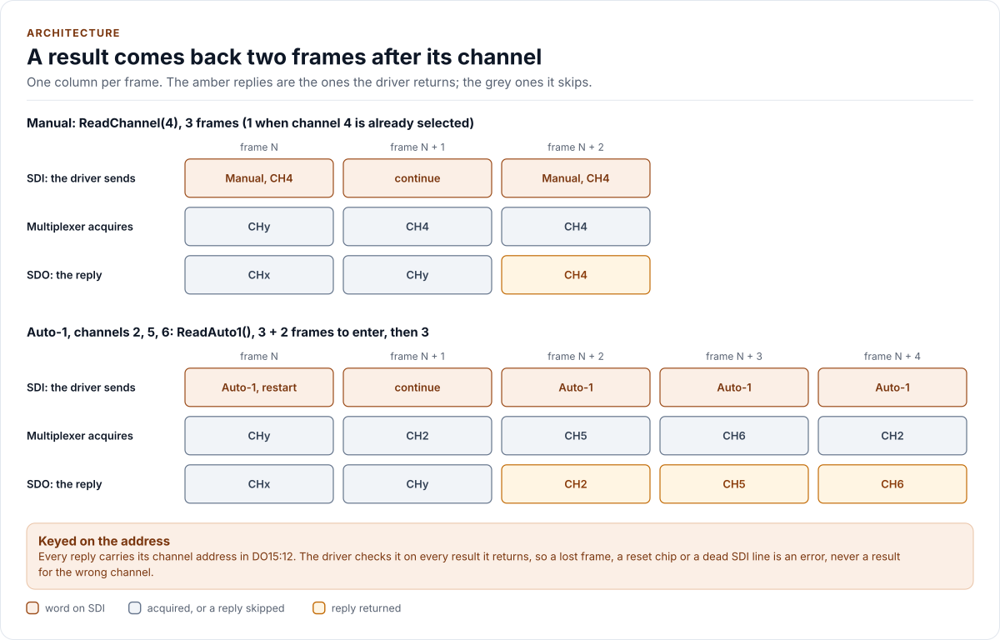

# Hardware

The ADS7950, ADS7951, ADS7952 and ADS7953: pins, bus settings, the frame, the modes, the program registers and
power, as the driver uses them. Values are from the datasheet; when your schematic disagrees on pin numbers, the
schematic wins.

<!-- generated: datasheet-refs -->
??? abstract "Datasheet sections this page relies on"

    From Texas Instruments SLAS605 C:

    - The family, its channel counts and resolutions: 1 Features; 3 Description; 5 Device Comparison Table, [p. 1](https://www.ti.com/lit/ds/symlink/ads7952.pdf#page=1)
    - Pins, packages and the GPIOs each package brings out: 6 Pin Configuration and Functions, [p. 5](https://www.ti.com/lit/ds/symlink/ads7952.pdf#page=5)
    - Absolute limits of the inputs and supplies: 7.1 Absolute Maximum Ratings, [p. 10](https://www.ti.com/lit/ds/symlink/ads7952.pdf#page=10)
    - Supplies, reference and SCLK limits: 7.3 Recommended Operating Conditions, [p. 10](https://www.ti.com/lit/ds/symlink/ads7952.pdf#page=10)
    - Input ranges, power-up time and the invalid first conversion: 7.6 Electrical Characteristics (ADS7950 to ADS7953), [p. 12](https://www.ti.com/lit/ds/symlink/ads7952.pdf#page=12)
    - Serial timing, CS high time and the 16-clock frame: 7.9 Timing Requirements; Figures 1 and 2, [p. 17](https://www.ti.com/lit/ds/symlink/ads7952.pdf#page=17)
    - Frame, reply word, GPIO refresh and alarm timing: 8.1 Overview, [p. 28](https://www.ti.com/lit/ds/symlink/ads7952.pdf#page=28)
    - The external reference and its 10 µF capacitor: 8.3.1 Reference, [p. 29](https://www.ti.com/lit/ds/symlink/ads7952.pdf#page=29)
    - Channel sequencing modes and the program registers' reset values: 8.4.1 Channel Sequencing Modes; 8.4.2 Device Programming and Mode Control, [p. 29](https://www.ti.com/lit/ds/symlink/ads7952.pdf#page=29)
    - Manual mode and the two-frame read latency: 8.4.4 Operating in Manual Mode, Figures 50 and 51, Table 1, [p. 31](https://www.ti.com/lit/ds/symlink/ads7952.pdf#page=31)
    - Auto-1 mode and its program register: 8.4.5 Operating in Auto-1 Mode, Figures 52 to 54, Tables 2 to 4, [p. 34](https://www.ti.com/lit/ds/symlink/ads7952.pdf#page=34)
    - Auto-2 mode and its program register: 8.4.6 Operating in Auto-2 Mode, Figures 55 to 57, Tables 5 and 6, [p. 38](https://www.ti.com/lit/ds/symlink/ads7952.pdf#page=38)
    - The "continue" word: 8.4.7 Continued Operation in a Selected Mode, Table 7, [p. 41](https://www.ti.com/lit/ds/symlink/ads7952.pdf#page=41)
    - GPIO program register and the register reset: 8.5.2 GPIO Registers, Figure 58, Table 11, [p. 42](https://www.ti.com/lit/ds/symlink/ads7952.pdf#page=42)
    - Alarm thresholds: 8.5.3 Alarm Thresholds for GPIO Pins, Figure 59, Tables 12 and 13, [p. 43](https://www.ti.com/lit/ds/symlink/ads7952.pdf#page=43)
    - Analog input, source impedance and MXO to AINP: 9.1.1 Analog Input, Figures 60 and 61, [p. 46](https://www.ti.com/lit/ds/symlink/ads7952.pdf#page=46)
    - Supply range, decoupling and +VA at or above +VBD: 10 Power Supply Recommendations, [p. 51](https://www.ti.com/lit/ds/symlink/ads7952.pdf#page=51)

    All of them, with the driver API for each: [Datasheet map](datasheet.md).
<!-- /generated -->

## The family

| Part | Channels | Resolution | Supported |
| --- | --- | --- | --- |
| ADS7950, ADS7951, ADS7952, ADS7953 | 4, 8, 12, 16 | 12 bits | Yes: `Config::variant` |
| ADS7954, ADS7955, ADS7956, ADS7957 | 4, 8, 12, 16 | 10 bits | No |
| ADS7958, ADS7959, ADS7960, ADS7961 | 4, 8, 12, 16 | 8 bits | No |

All twelve share the frame, the modes and the registers and are pin compatible within a package size (section 5).
The 10- and 8-bit parts put fewer result bits in DO11:00 and compare their alarm thresholds differently (Table 13);
the driver handles the 12-bit members only. The class is named after the ADS7952, the part it was written for.

## Pins

The ADS7952 in the 38-pin TSSOP (DBT); the other parts and the 32-pin VQFN (RHB) use other numbers (section 6). The
pinout, the block diagram, the circuit and the two tables on this page are drawn from
[`docs/hardware.yml`](hardware.yml).

<!-- figure: chip-pinout -->
<picture>
  <source media="(prefers-color-scheme: dark)" srcset="diagrams/chip-pinout.dark.svg">
  
</picture>
<!-- /figure -->

<!-- generated: chip-pins -->
TSSOP-38, 38 pins (6 Pin Configuration and Functions, [p. 5](https://www.ti.com/lit/ds/symlink/ads7952.pdf#page=5)).

| Pin | Name | Type (domain) | Function | Driver hook | If unused | Datasheet |
| --- | --- | --- | --- | --- | --- | --- |
| 1 | `GPIO2` | digital in/out (+VBD) | GPIO2, or the range input: high selects Range 2, low Range 1 | - | - | 6, [p. 7](https://www.ti.com/lit/ds/symlink/ads7952.pdf#page=7) |
| 2 | `GPIO3` | digital in/out (+VBD) | GPIO3, or the power-down input, active low | - | - | 6, [p. 7](https://www.ti.com/lit/ds/symlink/ads7952.pdf#page=7) |
| 3 | `REFM` | analog (+VA) | Reference ground | - | - | 6, [p. 6](https://www.ti.com/lit/ds/symlink/ads7952.pdf#page=6) |
| 4 | `REFP` | analog (+VA) | Reference input, 2.5 V external reference; 10 µF ceramic to REFM, close to the pins | - | - | 8.3.1, [p. 29](https://www.ti.com/lit/ds/symlink/ads7952.pdf#page=29) |
| 5 | `+VA` | power (+VA) | Analog supply, 2.7 V to 5.25 V; 1 µF ceramic at the pin | - | - | 10, [p. 51](https://www.ti.com/lit/ds/symlink/ads7952.pdf#page=51) |
| 6 | `AGND` | ground | Analog ground | - | - | 6, [p. 7](https://www.ti.com/lit/ds/symlink/ads7952.pdf#page=7) |
| 7 | `MXO` | analog (+VA) | Multiplexer output; to AINP, directly or through a buffer | - | - | 9.1.1, [p. 46](https://www.ti.com/lit/ds/symlink/ads7952.pdf#page=46) |
| 8 | `AINP` | analog (+VA) | ADC input | - | - | 6, [p. 6](https://www.ti.com/lit/ds/symlink/ads7952.pdf#page=6) |
| 9 | `AINM` | analog (+VA) | ADC input ground | - | - | 6, [p. 6](https://www.ti.com/lit/ds/symlink/ads7952.pdf#page=6) |
| 10 | `AGND` | ground | Analog ground | - | - | 6, [p. 7](https://www.ti.com/lit/ds/symlink/ads7952.pdf#page=7) |
| 11 | `NC` | not connected | Not connected inside; must not float | - | Connect to ground | 6, [p. 7](https://www.ti.com/lit/ds/symlink/ads7952.pdf#page=7) |
| 12 | `NC` | not connected | Not connected inside; must not float | - | Connect to ground | 6, [p. 7](https://www.ti.com/lit/ds/symlink/ads7952.pdf#page=7) |
| 13 | `NC` | not connected | Not connected inside; must not float | - | Connect to ground | 6, [p. 7](https://www.ti.com/lit/ds/symlink/ads7952.pdf#page=7) |
| 14 | `NC` | not connected | Not connected inside; must not float | - | Connect to ground | 6, [p. 7](https://www.ti.com/lit/ds/symlink/ads7952.pdf#page=7) |
| 15 | `CH11` | analog (+VA) | Analog input, channel 11 | - | - | 6, [p. 6](https://www.ti.com/lit/ds/symlink/ads7952.pdf#page=6) |
| 16 | `CH10` | analog (+VA) | Analog input, channel 10 | - | - | 6, [p. 6](https://www.ti.com/lit/ds/symlink/ads7952.pdf#page=6) |
| 17 | `CH9` | analog (+VA) | Analog input, channel 9 | - | - | 6, [p. 6](https://www.ti.com/lit/ds/symlink/ads7952.pdf#page=6) |
| 18 | `CH8` | analog (+VA) | Analog input, channel 8 | - | - | 6, [p. 6](https://www.ti.com/lit/ds/symlink/ads7952.pdf#page=6) |
| 19 | `AGND` | ground | Analog ground | - | - | 6, [p. 7](https://www.ti.com/lit/ds/symlink/ads7952.pdf#page=7) |
| 20 | `AGND` | ground | Analog ground | - | - | 6, [p. 7](https://www.ti.com/lit/ds/symlink/ads7952.pdf#page=7) |
| 21 | `CH7` | analog (+VA) | Analog input, channel 7 | - | - | 6, [p. 6](https://www.ti.com/lit/ds/symlink/ads7952.pdf#page=6) |
| 22 | `CH6` | analog (+VA) | Analog input, channel 6 | - | - | 6, [p. 6](https://www.ti.com/lit/ds/symlink/ads7952.pdf#page=6) |
| 23 | `CH5` | analog (+VA) | Analog input, channel 5 | - | - | 6, [p. 6](https://www.ti.com/lit/ds/symlink/ads7952.pdf#page=6) |
| 24 | `CH4` | analog (+VA) | Analog input, channel 4 | - | - | 6, [p. 6](https://www.ti.com/lit/ds/symlink/ads7952.pdf#page=6) |
| 25 | `CH3` | analog (+VA) | Analog input, channel 3 | - | - | 6, [p. 6](https://www.ti.com/lit/ds/symlink/ads7952.pdf#page=6) |
| 26 | `CH2` | analog (+VA) | Analog input, channel 2 | - | - | 6, [p. 6](https://www.ti.com/lit/ds/symlink/ads7952.pdf#page=6) |
| 27 | `CH1` | analog (+VA) | Analog input, channel 1 | - | - | 6, [p. 6](https://www.ti.com/lit/ds/symlink/ads7952.pdf#page=6) |
| 28 | `CH0` | analog (+VA) | Analog input, channel 0 | - | - | 6, [p. 6](https://www.ti.com/lit/ds/symlink/ads7952.pdf#page=6) |
| 29 | `+VA` | power (+VA) | Analog supply, 2.7 V to 5.25 V; 1 µF ceramic at the pin | - | - | 10, [p. 51](https://www.ti.com/lit/ds/symlink/ads7952.pdf#page=51) |
| 30 | `AGND` | ground | Analog ground | - | - | 6, [p. 7](https://www.ti.com/lit/ds/symlink/ads7952.pdf#page=7) |
| 31 | `CS` | bus (+VBD) | Chip select, active low; each falling edge samples the input and starts a frame | `Transfer()` | - | 6, [p. 7](https://www.ti.com/lit/ds/symlink/ads7952.pdf#page=7) |
| 32 | `SCLK` | bus (+VBD) | Serial clock, up to 20 MHz | `Transfer()` | - | 7.3, [p. 10](https://www.ti.com/lit/ds/symlink/ads7952.pdf#page=10) |
| 33 | `SDI` | bus (+VBD) | Serial data in (MOSI): the 16-bit command word | `Transfer()` | - | 6, [p. 7](https://www.ti.com/lit/ds/symlink/ads7952.pdf#page=7) |
| 34 | `SDO` | bus (+VBD) | Serial data out (MISO): the 16-bit reply | `Transfer()` | - | 6, [p. 7](https://www.ti.com/lit/ds/symlink/ads7952.pdf#page=7) |
| 35 | `BDGND` | ground | Digital ground | - | - | 6, [p. 7](https://www.ti.com/lit/ds/symlink/ads7952.pdf#page=7) |
| 36 | `+VBD` | power (+VBD) | Digital I/O supply, 1.7 V to +VA; 1 µF ceramic at the pin | - | - | 10, [p. 51](https://www.ti.com/lit/ds/symlink/ads7952.pdf#page=51) |
| 37 | `GPIO0` | digital in/out (+VBD) | GPIO0, or the alarm output (high or low, or high only), active high | - | - | 6, [p. 7](https://www.ti.com/lit/ds/symlink/ads7952.pdf#page=7) |
| 38 | `GPIO1` | digital in/out (+VBD) | GPIO1, or the low alarm output, active high | - | - | 6, [p. 7](https://www.ti.com/lit/ds/symlink/ads7952.pdf#page=7) |

Source of this table and of the chip figures: [`docs/hardware.yml`](hardware.yml).
<!-- /generated -->

The GPIOs are not port hooks: the driver sets and reads them through the SPI frame (`GpioConfig`,
`SetGpioOutputs()`, `ReadGpio()`), so the table shows no hook for them. The VQFN packages bring out GPIO0 only; set
`Config::package = Package::Vqfn` and the driver programs the missing GPIO1 to GPIO3 as outputs, as Table 11
requires.

## Inside the chip

<!-- figure: chip-blocks -->
<picture>
  <source media="(prefers-color-scheme: dark)" srcset="diagrams/chip-blocks.dark.svg">
  
</picture>
<!-- /figure -->

## Typical application

Figure 60 with what sections 9.1 and 10 add: MXO shorted to AINP, a 2.5 V reference on REFP with 10 µF to REFM, 1 µF
at each supply pin and 150 pF from each used input to ground. The unused inputs and GPIOs are left out of the
circuit; the NC pins go to ground, as section 6 requires.

<!-- figure: chip-circuit-typical -->
<picture>
  <source media="(prefers-color-scheme: dark)" srcset="diagrams/chip-circuit-typical.dark.svg">
  
</picture>
<!-- /figure -->

<!-- generated: chip-parts -->
| Part | Kind | Value | Connects | Datasheet |
| --- | --- | --- | --- | --- |
| U2 | MCU | - | VDD: +3V3, GND: GND, SCK: SCLK, MOSI: SDI, MISO: SDO, CS: CS | 9.1.1, [p. 46](https://www.ti.com/lit/ds/symlink/ads7952.pdf#page=46) |
| U3 | REF5025 | - (not confirmed: Figure 60 shows only the reference's output; its supply and decoupling are the reference's own) | VIN: +5V, GND: GND, OUT: VREF | 9.1.1, [p. 46](https://www.ti.com/lit/ds/symlink/ads7952.pdf#page=46) |
| C1 | capacitor | 10 µF | GND, VREF | 8.3.1, [p. 29](https://www.ti.com/lit/ds/symlink/ads7952.pdf#page=29) |
| C2 | capacitor | 1 µF | +5V, GND | 10, [p. 51](https://www.ti.com/lit/ds/symlink/ads7952.pdf#page=51) |
| C3 | capacitor | 1 µF | +3V3, GND | 10, [p. 51](https://www.ti.com/lit/ds/symlink/ads7952.pdf#page=51) |
| C4 | capacitor | 150 pF | GND, CH0 | 9.1, [p. 46](https://www.ti.com/lit/ds/symlink/ads7952.pdf#page=46) |
| C5 | capacitor | 150 pF | GND, CH1 | 9.1, [p. 46](https://www.ti.com/lit/ds/symlink/ads7952.pdf#page=46) |

Export a circuit for a schematic or PCB tool: `kokeb-docs hardware --kicad-netlist OUT.net --circuit typical`.
<!-- /generated -->

## Bus settings

| Setting | Value |
| --- | --- |
| Mode | 0: SDI latched on the rising edge, SDO changes on the falling edge (Figure 2) |
| fSCLK max | 20 MHz at any +VBD (section 7.9) |
| tw1, CS high min | 20 ns |
| Frame | Exactly 16 clocks with CS low; CS may go high only after the 16th (section 8.1) |
| Transfer from the driver | Always 2 bytes, one frame; CS must toggle between frames |

The SCLK rate sets the timing of the analog side: the multiplexer switches on the second falling edge of a frame and the
next channel acquires from the 14th rising edge to the next CS falling edge (section 8.1). A slow clock and gaps between
frames give a high-impedance source more time to settle. The acquisition time is 325 ns minimum (section 7.6), and
with MXO shorted to AINP the source impedance should be 50 Ω or less, since a higher one slows settling after a
channel change (section 9.1.1). To check your input network, read the same inputs at your SCLK and at 1 MHz and
compare the means: a difference of more than 1 to 2 LSB calls for a lower source impedance or a buffer between MXO
and AINP (section 9.2.2).

## The frame

<!-- figure: frame-pipeline -->
<picture>
  <source media="(prefers-color-scheme: dark)" srcset="diagrams/frame-pipeline.dark.svg">
  
</picture>
<!-- /figure -->

Each frame is one 16-bit word in and one out, MSB first. The word in (DI15:00) has its command in DI15:12:

| DI15:12 | Word | Driver use |
| --- | --- | --- |
| 0000 | Continue in the current mode; DI11:00 ignored (Table 7) | Every frame that only reads |
| 0001 | Manual mode, next channel in DI10:07 (Table 1) | `ReadChannel()`, `ReadChannels()`, the identity check |
| 0010, 0011 | Auto-1, Auto-2 mode (Tables 2, 5) | `ReadAuto1()`, `ReadAuto2()` |
| 0100 | GPIO program register (Table 11) | Start-up reset, `GpioConfig` |
| 1000 | Auto-1 program: the mask follows in the next frame (Table 3) | `SetAuto1Channels()` |
| 1001 | Auto-2 program: last channel in DI09:06 (Table 6) | `SetAuto2LastChannel()` |
| 11bb | Alarm program, group bb; thresholds follow (Table 13) | `SetAlarmThresholds()` |

In a mode word, DI11 = 1 makes the chip take DI06:00 (DI10:00 in the Auto modes); with DI11 = 0 it keeps the previous
values. DI10 restarts an Auto sequence; DI06 is the range; DI05 powers down; DI04 makes the next reply carry the GPIO
levels instead of the channel address; DI03:00 are the GPIO output levels. The driver always sends DI11 = 1 with the
configured range and levels, and DI04 = DI05 = 0 except where a call needs them.

The word out has the channel address in DO15:12 and the 12-bit result, straight binary, in DO11:00
(`reg::ReplyAddress()`, `reg::ReplyCode()`). It is the conversion of the input sampled at that frame's CS falling
edge, which the multiplexer acquired during the frame before, which the frame before that chose: **a channel chosen
in frame N comes back in frame N + 2** (Figure 51). A range written in frame N applies from the same result. The
first conversion after power-up or a reset is invalid (section 7.6).

## Modes

| Mode | Channels | Frames per result |
| --- | --- | --- |
| Manual | The one each word names | 3 for a new channel, then 1 for each repeat |
| Auto-1 | The channels of a 16-bit mask, ascending, wrapping | 1, after 2 to enter |
| Auto-2 | Channel 0 up to a last channel, wrapping | 1, after 2 to enter |

Entering an Auto mode from another mode restarts its sequence (sections 8.4.5 and 8.4.6). Writing the Auto-1 mask
while in Auto-1 moves the chip on to the next enabled channel of the new mask; writing the Auto-2 last channel while
in Auto-2 restarts it at channel 0. The chip keeps converting in its mode while a program register is written, and
its replies stay valid.

## Program registers and their reset values

| Register | Reset value | `Config` field |
| --- | --- | --- |
| Mode control | Manual, channel 0, Range 1, GPIO outputs low | `range`, `gpio.output_levels` |
| Auto-1 mask | Every channel (0x000F, 0x00FF, 0x0FFF, 0xFFFF) | `auto1_channels` |
| Auto-2 last channel | The last channel (3, 7, 11, 15) | `auto2_last_channel` |
| GPIO | Every pin an input, no function | `gpio` |
| Alarm thresholds | High all ones, low all zeros: no alarm | `alarms` |

DI09 of the GPIO program word resets every register "in the next CS frame" (Table 11): `EnsureInitialized()` uses it
as the chip's software reset, then writes every register. The chip has no way to read a register back.

## Alarms

Each channel has a high and a low threshold of 10 bits, compared with the upper 10 bits of each result (Table 13):
the two lowest bits of a code do not count. GPIO0 can be the "high or low" or the high alarm output and GPIO1 the low
alarm output (TSSOP only), active high, set on the 12th SCLK of the frame that converts the channel and cleared on
the 10th SCLK of the next (section 8.1). Programming a group of four channels takes the group frame, one frame per
threshold and one frame to leave the sequence.

## Power

| Item | Value |
| --- | --- |
| +VA | 2.7 V to 5.25 V |
| +VBD | 1.7 V to +VA |
| VREF | 2.0 V to 3.0 V, 2.5 V nominal; lower than 2.4 V costs noise (section 7.6) |
| Range 2 | 0 to 2 x VREF, only while 2 x VREF <= +VA (section 7.6): `Validate()` checks it with `vref_mv` and `va_min_mv`, the lowest +VA the board guarantees |
| Inputs | -0.3 V to +VA + 0.3 V, absolute (section 7.1) |
| Decoupling | 1 µF ceramic at each supply pin; 10 µF ceramic from REFP to REFM, next to the pins (sections 8.3.1, 10) |
| Power-down | DI05 = 1: down at the end of the next frame (section 8.3.2); about 1 µA |
| Power-up | 1 µs, then one invalid conversion (section 7.6) |

Choosing VREF and the range for a supply, the scale monitor, ratiometric sensors and the layout rules: [Reference,
range and supplies](reference-and-supplies.md).

`Deinitialize()` powers the chip down. `EnsureInitialized()` wakes it through the reset, waits `kPowerUpUs` with the
port's `DelayUs()` and discards the invalid conversion.

<!-- generated: datasheet-card -->
| Document | Revision | Get it |
| --- | --- | --- |
| Datasheet: ADS79xx 12-, 10-, 8-Bit, 1-MSPS, 16-, 12-, 8-, 4-Channel, Single-Ended, Serial Interface ADCs (Texas Instruments SLAS605) | C, 2018-07 | [PDF](https://www.ti.com/lit/ds/symlink/ads7952.pdf) · [vendor page](https://www.ti.com/product/ADS7952) |

Written against these revisions; the SHA-256 of each file is in [`docs/datasheets.yml`](datasheets.yml). Where each part
of the driver is in the datasheet: [Datasheet map](datasheet.md).
<!-- /generated -->
