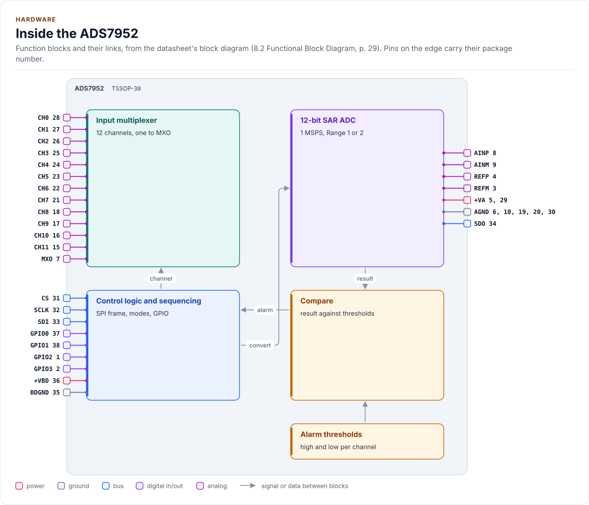
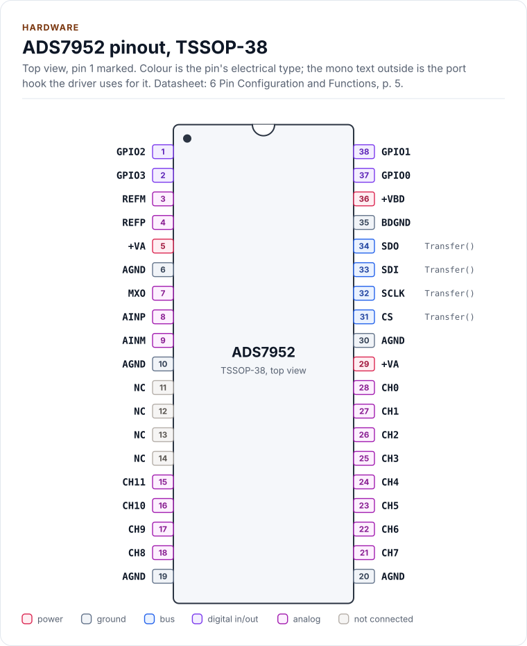
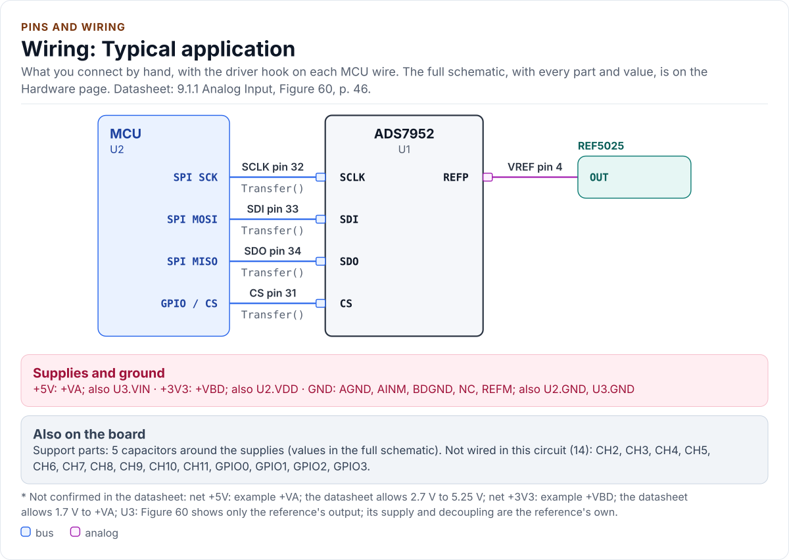
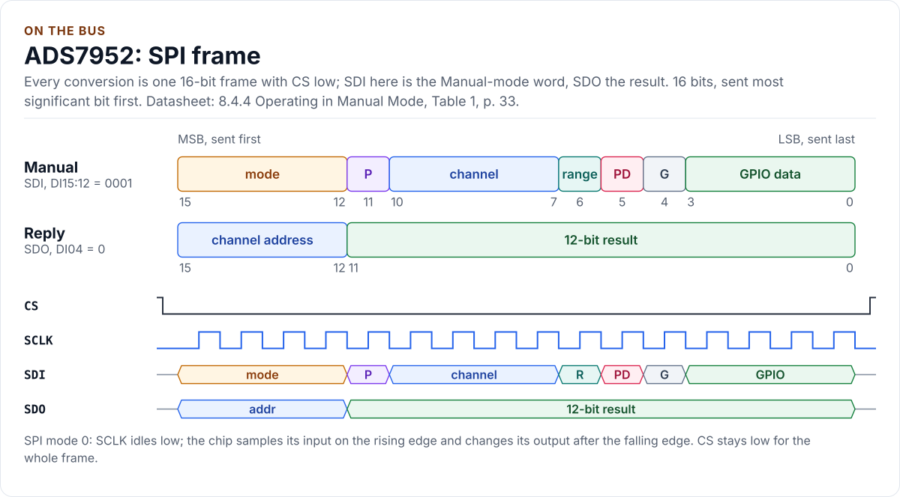

---
hide:
  - navigation
  - toc
---

<div class="kb-hero" markdown>
<span class="kb-kicker">Driver</span>

# ADS7952 Driver

<p>A C++20 driver for the TI ADS7950, ADS7951, ADS7952 and ADS7953 12-bit SAR ADCs. It checks that the chip
really answers, reads channels one at a time or as a scan with the fewest frames the chip allows, and keys every
result on the channel address in its reply, on any MCU.</p>

[Quickstart](quickstart.md){ .md-button .md-button--primary }
[API guide](api-guide.md){ .md-button }
[Source on GitHub](https://github.com/kokeb-labs-drivers/driver-ads7952){ .md-button }
</div>

<!-- generated: chip-summary -->
The **ADS7952** is a 12-channel, 12-bit SAR analog-to-digital converter that samples one single-ended input per 16-bit
SPI frame at up to 1 MSPS, in a manual order or in one of two automatic sequences (1 Features, [p.
1](https://www.ti.com/lit/ds/symlink/ads7952.pdf#page=1)).
<!-- /generated -->

<!-- figure: chip-hero -->
<picture>
  <source media="(prefers-color-scheme: dark)" srcset="diagrams/chip-hero.dark.svg">
  
</picture>
<!-- /figure -->

## What it does

<!-- figure: chip-capabilities -->
<picture>
  <source media="(prefers-color-scheme: dark)" srcset="diagrams/chip-capabilities.dark.svg">
  
</picture>
<!-- /figure -->

## Where it is used

<!-- generated: chip-uses -->
- PLC and industrial PC inputs (2, [p. 1](https://www.ti.com/lit/ds/symlink/ads7952.pdf#page=1))
- Optical line card monitoring (2, [p. 1](https://www.ti.com/lit/ds/symlink/ads7952.pdf#page=1))
- Medical instrumentation (2, [p. 1](https://www.ti.com/lit/ds/symlink/ads7952.pdf#page=1))
- Digital power supplies (2, [p. 1](https://www.ti.com/lit/ds/symlink/ads7952.pdf#page=1))
- Multichannel signal monitoring (2, [p. 1](https://www.ti.com/lit/ds/symlink/ads7952.pdf#page=1))
- High-speed data acquisition (2, [p. 1](https://www.ti.com/lit/ds/symlink/ads7952.pdf#page=1))
- High-speed closed-loop systems (2, [p. 1](https://www.ti.com/lit/ds/symlink/ads7952.pdf#page=1))

Uses named by the datasheet (1 Features, [p. 1](https://www.ti.com/lit/ds/symlink/ads7952.pdf#page=1)).
<!-- /generated -->

## Inside the chip

<!-- figure: chip-blocks -->
<picture>
  <source media="(prefers-color-scheme: dark)" srcset="diagrams/chip-blocks.dark.svg">
  
</picture>
<!-- /figure -->

## Pins and wiring

<!-- figure: chip-pinout -->
<picture>
  <source media="(prefers-color-scheme: dark)" srcset="diagrams/chip-pinout.dark.svg">
  
</picture>
<!-- /figure -->

<!-- figure: chip-wiring-typical -->
<picture>
  <source media="(prefers-color-scheme: dark)" srcset="diagrams/chip-wiring-typical.dark.svg">
  
</picture>
<!-- /figure -->

<!-- figure: chip-frame-spi -->
<picture>
  <source media="(prefers-color-scheme: dark)" srcset="diagrams/chip-frame-spi.dark.svg">
  
</picture>
<!-- /figure -->

<div class="kb-chip" markdown>
<div class="kb-chip__head">
<span class="kb-chip__kicker">12-bit SAR ADC</span>
<span class="kb-chip__name">ADS7952</span>
<span class="kb-chip__vendor">Texas Instruments</span>
</div>

Function
:   12 single-ended channels (4, 8 or 16 on the ADS7950, ADS7951, ADS7953), 12 bits, up to 1 MSPS

Interface
:   SPI mode 0, up to 20 MHz; one 16-bit frame per conversion, the result two frames after its channel

Modes
:   Manual (any channel per frame), Auto-1 (a programmed list), Auto-2 (channel 0 to a last channel)

Ranges
:   0 to VREF or 0 to 2 x VREF, with an external 2.0 V to 3.0 V reference

Extras
:   Two alarm thresholds per channel on GPIO0 and GPIO1; four GPIOs (TSSOP); power-down

Supply
:   +VA 2.7 V to 5.25 V, +VBD 1.7 V to +VA
</div>

Every pin, the reference circuits, the bus settings, the timing and the power: [Hardware](hardware.md).

## Quick start

Wire the chip as above, write the port for your MCU ([Porting](porting.md)), then:

<!-- generated: quickstart-code -->
```cpp
#include "ads7952.hpp"

int read_input_3(MyPort& port, uint32_t& microvolts) {
  ads7952::ADS7952<MyPort> adc(port); // no I/O yet; Config{} is an ADS7952 at its reset state

  if (auto r = adc.EnsureInitialized(); !r) { // 1. bus up, reset, registers, identity check
    return static_cast<int>(r.error);         //    Bus, NoDevice or DeviceIdMismatch: check wiring
  }
  const auto code = adc.ReadChannel(3); // 2. Manual mode: select, acquire, convert
  if (!code) {
    return static_cast<int>(code.error); //    ChannelMismatch: a reply for another channel
  }
  microvolts = adc.ToMicrovolts(code.value); // 3. 0 to VREF, one LSB = VREF / 4096
  return 0;
}
```
<!-- /generated -->

Step by step, from a bare chip to the first result: [Quickstart](quickstart.md).

## Driver coverage

<!-- generated: chip-coverage -->
| Capability | What the chip does | Driver API | Registers | Status | Datasheet |
| --- | --- | --- | --- | --- | --- |
| [Manual mode](api-guide.md) | Converts the channel each frame names; the result comes two frames later, tagged with its channel | `ReadChannel`, `ReadChannels` | `kManual`, `kProgramEnable` | Supported | 8.4.4, [p. 31](https://www.ti.com/lit/ds/symlink/ads7952.pdf#page=31) |
| [Auto-1 sequence](api-guide.md) | Scans a programmed list of channels in ascending order, one per frame | `SetAuto1Channels`, `ReadAuto1` | `kAuto1`, `kAuto1Program` | Supported | 8.4.5, [p. 34](https://www.ti.com/lit/ds/symlink/ads7952.pdf#page=34) |
| [Auto-2 sequence](api-guide.md) | Scans from channel 0 up to a programmed last channel, one per frame | `SetAuto2LastChannel`, `ReadAuto2` | `kAuto2`, `kAuto2Program` | Supported | 8.4.6, [p. 38](https://www.ti.com/lit/ds/symlink/ads7952.pdf#page=38) |
| [Input range](configuration.md) | Selects 0 to VREF or 0 to 2 x VREF, and converts codes to microvolts | `SetRange`, `Range`, `ToMicrovolts` | `kRangeTwoVref`, `kGpio2Range` | Supported | 8.4.4, [p. 33](https://www.ti.com/lit/ds/symlink/ads7952.pdf#page=33) |
| [Alarm thresholds](api-guide.md) | A high and a low threshold per channel, signalled on GPIO0 and GPIO1 | `SetAlarmThresholds`, `AlarmThreshold` | `kAlarmProgramGroup0`, `kAlarmHigh` | Supported | 8.5.3, [p. 43](https://www.ti.com/lit/ds/symlink/ads7952.pdf#page=43) |
| [GPIOs](api-guide.md) | Four pins on TSSOP, one on VQFN, each an input or an output, read and written with the frames | `SetGpioOutputs`, `ReadGpio` | `kGpioProgram`, `kGpioReadout`, `kGpioDataMask` | Supported | 8.5.2, [p. 42](https://www.ti.com/lit/ds/symlink/ads7952.pdf#page=42) |
| [Power-down](api-guide.md) | Powers the chip down at the end of a frame, by command or by the GPIO3 input | `Deinitialize` | `kPowerDown`, `kGpio3PowerDown` | Supported | 8.3.2, [p. 29](https://www.ti.com/lit/ds/symlink/ads7952.pdf#page=29) |
| [Reset and checks](contract.md) | Resets every register by command, waits the power-up time and checks that the chip answers | `EnsureInitialized`, `CheckScale` | `kGpioResetAll` | Supported | 8.4.3, [p. 30](https://www.ti.com/lit/ds/symlink/ads7952.pdf#page=30) |

**Supported**: the driver covers it and a host test checks it.

From [`docs/hardware.yml`](hardware.yml); `kokeb-docs hardware --check` confirms that every API name is in
`inc/ads7952.hpp`, `inc/ads7952_types.hpp` and every register in `inc/ads7952_registers.hpp`.
<!-- /generated -->

The driver has no platform code. You give it a small class that brings the bus up and moves one 16-bit frame at a
time; it does the rest: the reset, the identity check, the frame pipeline, the program sequences and the checks.

### What you get

- **One object per chip.** `ADS7952<YourPort>` takes a reference to your port and does no I/O until
  `EnsureInitialized()`. See [API guide](api-guide.md).
- **A start-up check a dead bus cannot pass.** Two channels selected, their addresses read back two frames later:
  MISO stuck, a fixed pattern or an SDI that never reaches the chip all fail. See [Contract](contract.md).
- **The minimum traffic.** A running Auto-1 scan costs one frame per channel; a repeated channel one frame. Extra
  read-backs are chosen per call. See [Contract](contract.md#timing).
- **Errors you can act on.** Every call returns `Result<T>` with an `Error` such as `Bus`, `ChannelMismatch` or
  `SequenceMismatch`. See [API guide](api-guide.md#handle-errors).
- **Zero-overhead portability.** The port is a CRTP class checked by a concept: a transfer and a delay, plus an
  optional logging hook. See [Porting](porting.md).
- **No heap, no exceptions, no RTTI.** The host tests build with `-fno-exceptions -fno-rtti`. See
  [Contract](contract.md).
- **Tested without hardware.** Host tests run the driver against a protocol model of the chip with the faults seen
  on hardware, and a fuzzer attacks every reply. See [Testing and CI](testing.md) and
  [Status and limitations](limitations.md).

## Datasheet

<!-- generated: datasheet-card -->
| Document | Revision | Get it |
| --- | --- | --- |
| Datasheet: ADS79xx 12-, 10-, 8-Bit, 1-MSPS, 16-, 12-, 8-, 4-Channel, Single-Ended, Serial Interface ADCs (Texas Instruments SLAS605) | C, 2018-07 | [PDF](https://www.ti.com/lit/ds/symlink/ads7952.pdf) · [vendor page](https://www.ti.com/product/ADS7952) |

Written against these revisions; the SHA-256 of each file is in [`docs/datasheets.yml`](datasheets.yml). Where each part
of the driver is in the datasheet: [Datasheet map](datasheet.md).
<!-- /generated -->

## Where to go next

<div class="grid cards" markdown>

-   :material-rocket-launch-outline: **[Quickstart](quickstart.md)**

    ---

    Wire the chip, write the port, read a channel in about 15 lines.

-   :material-chip: **[Hardware](hardware.md)**

    ---

    Pins, the frame, the modes, the registers and power.

-   :material-file-document-check-outline: **[Contract](contract.md)**

    ---

    What the driver promises, what it needs, threading and errors.

-   :material-code-braces: **[API guide](api-guide.md)**

    ---

    Start, read, scan, set ranges, alarms and GPIOs, and handle errors, task by task.

-   :material-swap-horizontal: **[Porting](porting.md)**

    ---

    Implement the port for your MCU.

-   :material-book-open-variant: **[API reference](api-reference.md)**

    ---

    Every class and member, generated from the headers.

</div>
